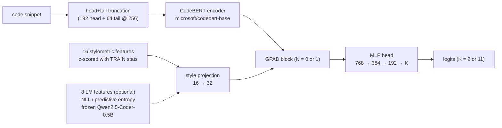
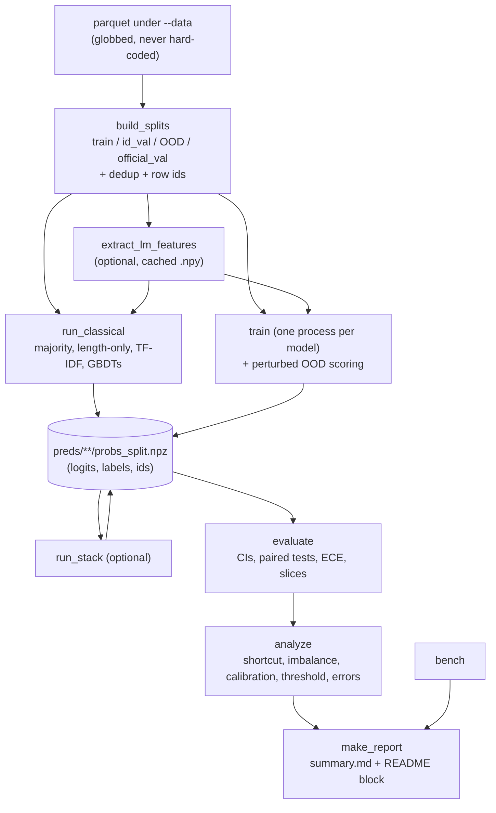

# Architecture

Two things are described here: the **model** (what GPAD actually computes) and the **pipeline** (how a run
turns parquet files into a report). They are separate on purpose — most of this project's value is in the
second one.

## 1. The model



Inside one GPAD block:

```
h ─► EntropyWeightedAttention ─► StyleFusion ─► FFN ─► LayerNorm ─► h'
         │                           │
         │                           └─ h + gate(h, s) · W·s     (s broadcast over tokens)
         │
         └─ scores = QKᵀ/√d  +  sign · α · σ(mean(H) − H_k)      ← the mechanism
                 where H_k = entropy of softmax(Q'(k)·K'(k)ᵀ/√d) over keys,
                 computed from the KEYS only, padding-masked.
```

Read that bias line carefully, because the original write-up got it wrong:

- `H_k` is the entropy of a **learned softmax over key self-similarity**. It is not the entropy of a
  language model's next-token distribution, and it is not computed over the vocabulary.
- `σ(mean(H) − H_k)` is **large when `H_k` is small**. So at `sign = +1` the bias *boosts low-entropy
  keys* — tokens whose learned self-similarity distribution is peaked. The old README claimed the
  opposite ("high entropy → more attention"). `gpad_sign_neg` runs the other direction as an ablation.
- The bias is added **pre-softmax, per key, broadcast over queries** — the same shape of intervention as
  ALiBi or a relative-position bias, except content-driven rather than positional.

Ablation flags (all one line in `codedet/zoo.py`):

| name | `num_gpad_layers` | `entropy_alpha` | `use_style` | what it isolates |
|---|---|---|---|---|
| `codebert` | 0 | — | no | the old baseline |
| `control` | 1 | **0** | **no** | **capacity**: same extra block, mechanism off |
| `gpad` | 1 | 0.15 | yes | the full idea |
| `gpad_entropy_only` | 1 | 0.15 | no | the bias alone |
| `gpad_style_only` | 1 | 0 | yes | the fusion alone |
| `gpad_sign_neg` | 1 | 0.15 (sign −1) | yes | the direction of the bias |
| `lora` | 0 | — | no | PEFT vs full fine-tune |

`gpad − codebert` measures the package. **`gpad − control` measures the mechanism.** Only the second one
is allowed to support a claim about entropy.

## 2. The pipeline



Three properties this layout buys:

1. **Evaluation never runs a model.** It reads `probs_*.npz` and aligns on `row_id`, so "every model saw
   the identical rows" is asserted in `summary.json` (`identical_rows`) rather than hoped for.
2. **Any stage can fail without taking the run with it.** `run_all.py` runs each stage as a subprocess
   with its own time cap, records the outcome in `status.json`, retries training once in a cheaper
   configuration, and writes `KNOWN_GAPS.md` for whatever did not happen.
3. **Re-running is cheap.** A finished stage drops a marker in `<out>/.done/`; re-running skips it unless
   `--force`. That is what makes a Kaggle session that dies at minute 40 recoverable.

## 3. Where each audit fix lives

| Audit finding | Fix | File |
|---|---|---|
| "Entropy" meant three different things | Mechanism renamed and documented; true predictive entropy is a separate module | `models/gpad.py`, `lm_features.py` |
| No capacity control | `control` variant, and the README branch is chosen from its paired CI | `zoo.py`, `scripts/evaluate.py` |
| Tables compared different row counts | Materialised splits + `row_id` alignment + `identical_rows` assertion | `splits.py`, `artifacts.py`, `scripts/evaluate.py` |
| Majority-class illusion on Task B | Train-only human cap, composition-targeted sampling, class-aware losses, macro-F1 | `splits.py`, `losses.py` |
| Unanalysed OOD collapse | Held-out language/generator splits, length-only probe, comment/whitespace stress test | `splits.py`, `classical.py`, `perturb.py` |
| Stylometry was Python-only (a language detector) | Language-agnostic features; `radon` kept only as a labelled legacy ablation | `features.py` |
| Per-batch stylometry inside `forward()`, padding to max length | Cached z-scored features, dynamic padding, head+tail truncation | `datasets.py`, `data.py` |
| HF Trainer + Accelerate monkey-patches broke across versions | Small explicit training loop with an OOM ladder | `trainloop.py` |
