# Appendix - every table behind the report

Generated by `scripts/make_report.py` from `results/*.json`. Do not edit by hand. The short version is [REPORT.md](REPORT.md).

## Task A - human or machine?

### All models, all splits

| id | model | in-distribution | official val set | unseen language | seeds | seed sd |
|---|---|---|---|---|---|---|
| A2 | Style features + gradient boosting | 0.957 [0.933, 0.977] | 0.960 [0.936, 0.980] | 0.754 [0.703, 0.798] | 3 | 0.000 |
| A8 | Stacked ensemble | 0.963 [0.943, 0.983] | 0.957 [0.930, 0.977] | 0.747 [0.700, 0.793] | 1 | - |
| A0b | Length + whitespace only (shortcut probe) | 0.903 [0.869, 0.936] | 0.889 [0.848, 0.925] | 0.513 [0.456, 0.569] | 3 | 0.000 |
| A4 | CodeBERT fine-tune | 0.943 [0.917, 0.967] | 0.930 [0.899, 0.957] | 0.509 [0.452, 0.566] | 1 | - |
| A6 | GPAD (entropy bias + style) | 0.950 [0.923, 0.973] | 0.933 [0.903, 0.960] | 0.477 [0.421, 0.531] | 1 | - |
| A7 | GPAD with the bias switched off (control) | 0.947 [0.920, 0.970] | 0.926 [0.895, 0.953] | 0.475 [0.419, 0.527] | 1 | - |
| A0a | Majority class (floor) | 0.344 [0.320, 0.367] | 0.344 [0.320, 0.368] | 0.344 [0.320, 0.368] | 1 | - |
| A1 | Character n-grams + logistic regression | 0.840 [0.797, 0.877] | 0.846 [0.806, 0.886] | 0.341 [0.317, 0.364] | 3 | 0.000 |

### Paired comparisons

Same rows. *different* = the bootstrap CI excludes zero **and** McNemar p < 0.05; if only one test says so, *unclear*.

| comparison | split | n | macro-F1 diff [95% CI] | McNemar p | verdict |
|---|---|---|---|---|---|
| gpad - control | in-distribution | 300 | +0.003 [+0.000, +0.010] | 1 | tie |
| gpad - control | official val set | 300 | +0.007 [+0.000, +0.017] | 0.5 | tie |
| gpad - control | unseen language | 300 | +0.002 [-0.013, +0.020] | 1 | tie |
| gpad - codebert | in-distribution | 300 | +0.007 [-0.007, +0.020] | 0.625 | tie |
| gpad - codebert | official val set | 300 | +0.003 [+0.000, +0.010] | 1 | tie |
| gpad - codebert | unseen language | 300 | -0.032 [-0.065, -0.000] | 0.791 | unclear (tests disagree) |
| tfidf_lr - length_only | in-distribution | 300 | -0.063 [-0.113, -0.018] | 0.0183 | **different** |
| tfidf_lr - length_only | official val set | 300 | -0.043 [-0.089, +0.004] | 0.0984 | tie |
| tfidf_lr - length_only | unseen language | 300 | -0.172 [-0.221, -0.117] | 0.000191 | **different** |

### Stress test: strip comments and formatting

Same OOD rows, macro-F1. *change* is perturbed minus original: negative = the model got worse.

| model | original | comments removed | change | comments + formatting stripped | change |
|---|---|---|---|---|---|
| CodeBERT fine-tune | 0.509 | 0.509 | +0.001 | 0.623 | +0.114 |
| GPAD with the bias switched off (control) | 0.475 | 0.492 | +0.018 | 0.342 | -0.133 |
| GPAD (entropy bias + style) | 0.477 | 0.492 | +0.015 | 0.342 | -0.135 |

### Calibration

GPAD (entropy bias + style); temperature fitted on in-distribution data: **T = 1.01**. Lower ECE is better.

| split | ECE raw | ECE after temperature |
|---|---|---|
| in-distribution | 0.027 | 0.027 |
| unseen language | 0.339 | 0.337 |

### Operating point

A false accusation costs **5x** a miss. The threshold is chosen on in-distribution data only, then applied unchanged to OOD.

| split | rule | threshold | precision (machine) | recall (machine) | false-accusation rate | cost / 1000 snippets |
|---|---|---|---|---|---|---|
| in-distribution | argmax_0.5 | 0.50 | 0.944 | 0.962 | 0.063 | 170 |
| in-distribution | cost_optimal | 0.90 | 0.967 | 0.943 | 0.035 | 113 |
| unseen language | argmax_0.5 | 0.50 | 0.555 | 0.968 | 0.853 | 2050 |
| unseen language | cost_optimal | 0.90 | 0.658 | 0.662 | 0.378 | 1077 |

### Per-class breakdown

GPAD (entropy bias + style), in-distribution:

| class | precision | recall | F1 | support |
|---|---|---|---|---|
| human | 0.957 | 0.937 | 0.947 | 143 |
| machine | 0.944 | 0.962 | 0.953 | 157 |

### Which style features matter

| feature | macro-F1 lost when shuffled (in-distribution) |
|---|---|
| tab_ratio | +0.2110 |
| mean_indent | +0.0375 |
| blank_ratio | +0.0274 |
| comment_line_ratio | +0.0141 |
| snake_ratio | +0.0054 |
| punct_density | +0.0047 |
| trailing_ws_ratio | +0.0047 |
| camel_ratio | +0.0027 |
| unique_ident_ratio | +0.0027 |
| long_line_share | +0.0007 |

### Figures

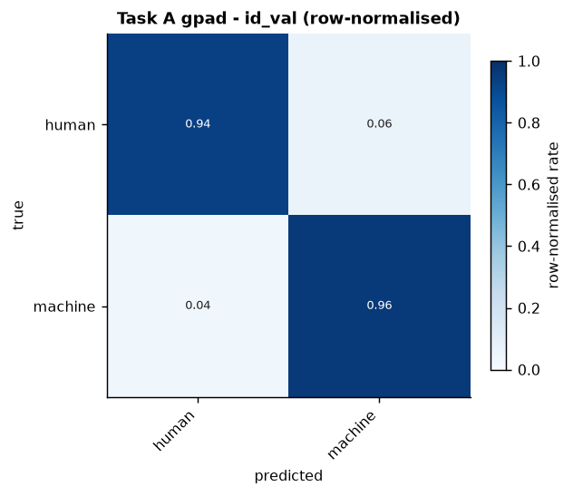
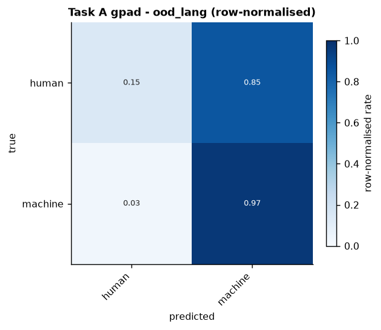
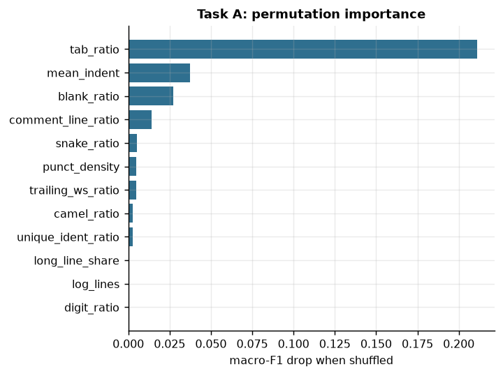
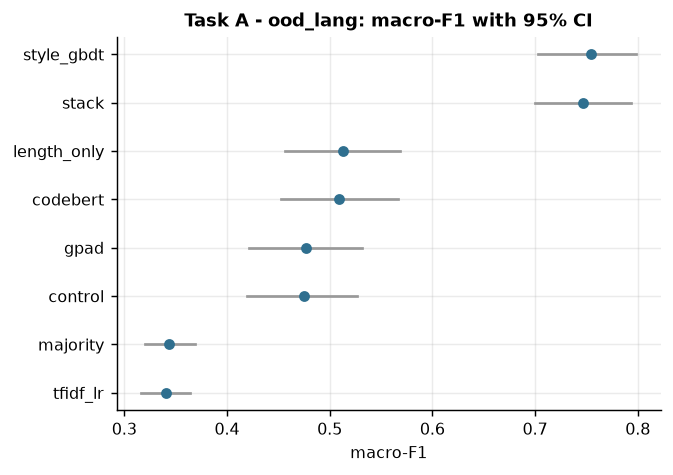
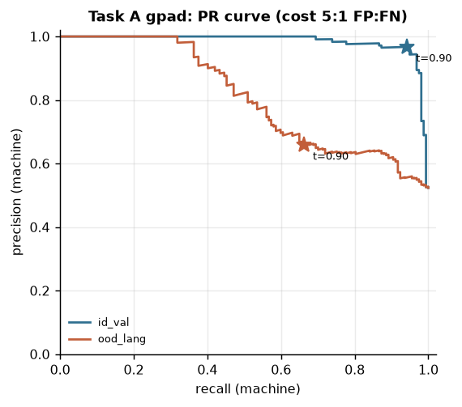
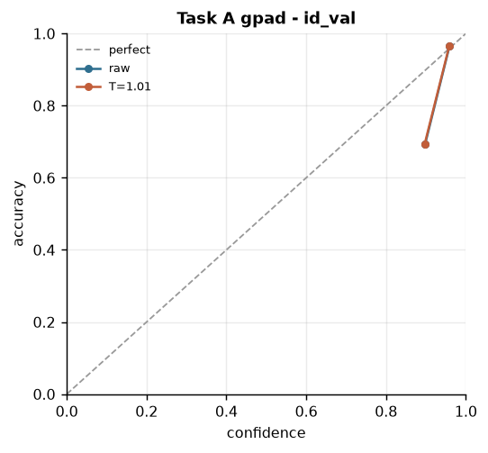
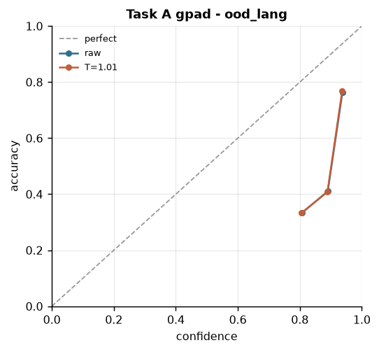
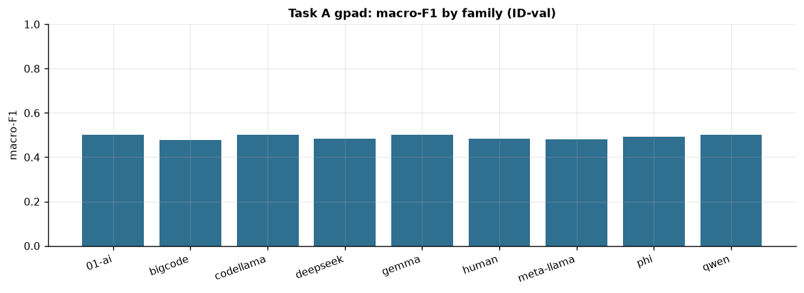
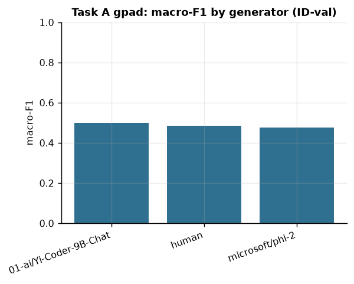
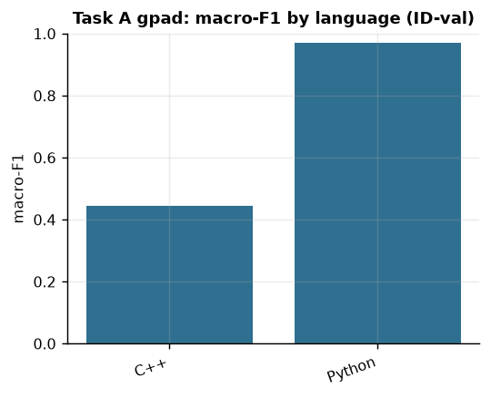

## Task B - which model family wrote it?

### All models, all splits

| id | model | in-distribution | official val set | unseen generator | seeds | seed sd |
|---|---|---|---|---|---|---|
| A1 | Character n-grams + logistic regression | 0.144 [0.091, 0.202] | 0.096 [0.068, 0.130] | 0.125 [0.088, 0.159] | 3 | 0.000 |
| A0a | Majority class (floor) | 0.085 [0.083, 0.087] | 0.085 [0.084, 0.087] | 0.087 [0.086, 0.089] | 1 | - |

### Paired comparisons

Same rows. *different* = the bootstrap CI excludes zero **and** McNemar p < 0.05; if only one test says so, *unclear*.

| comparison | split | n | macro-F1 diff [95% CI] | McNemar p | verdict |
|---|---|---|---|---|---|
| tfidf_lr - majority | in-distribution | 300 | +0.059 [+0.004, +0.116] | 5.46e-19 | **different** |
| tfidf_lr - majority | official val set | 299 | +0.011 [-0.018, +0.045] | 6.98e-26 | unclear (tests disagree) |
| tfidf_lr - majority | unseen generator | 300 | +0.038 [-0.000, +0.072] | 1.25e-23 | unclear (tests disagree) |

### Calibration

Character n-grams + logistic regression; temperature fitted on in-distribution data: **T = 0.14**. Lower ECE is better.

| split | ECE raw | ECE after temperature |
|---|---|---|
| in-distribution | 0.460 | 0.163 |
| unseen generator | 0.466 | 0.122 |

### Figures

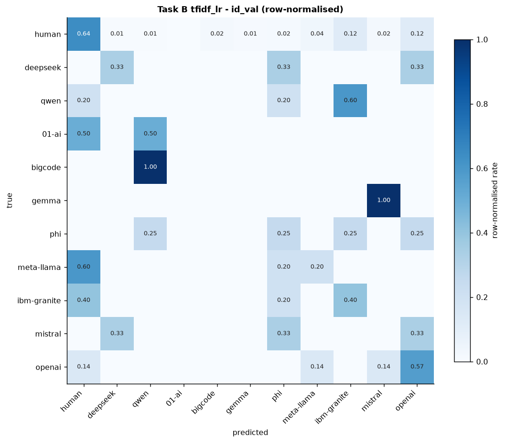
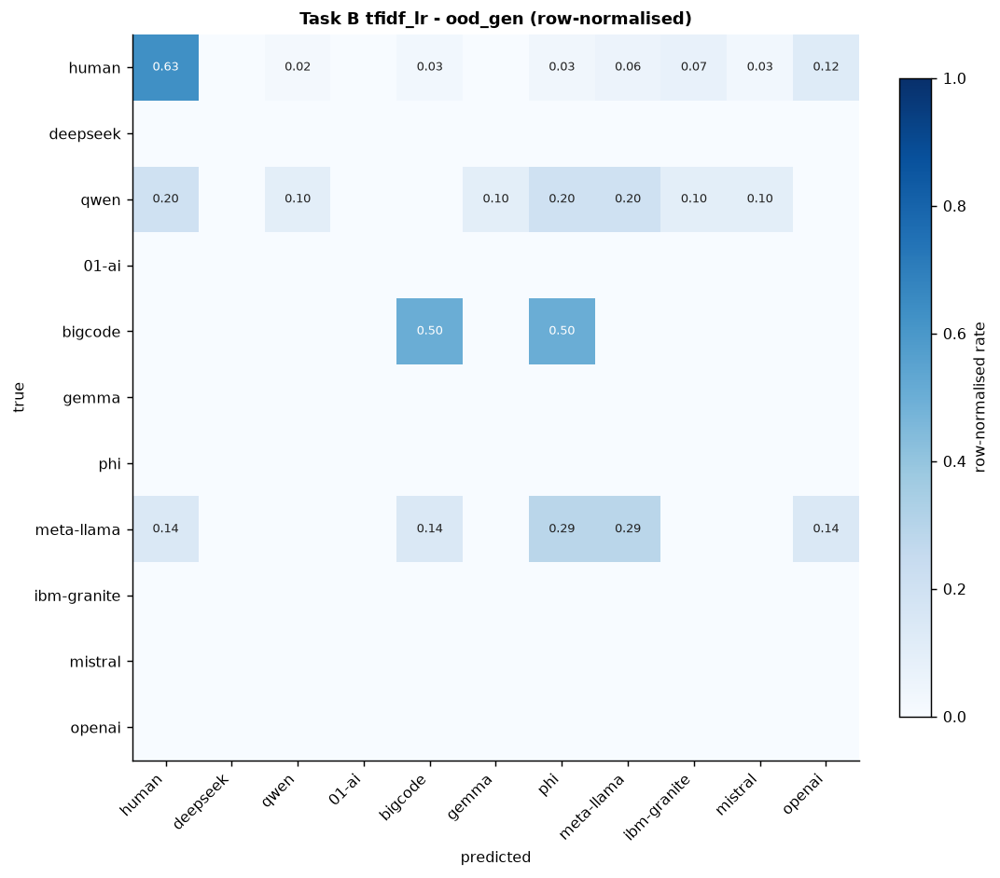
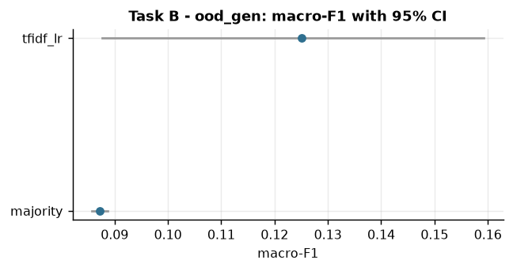
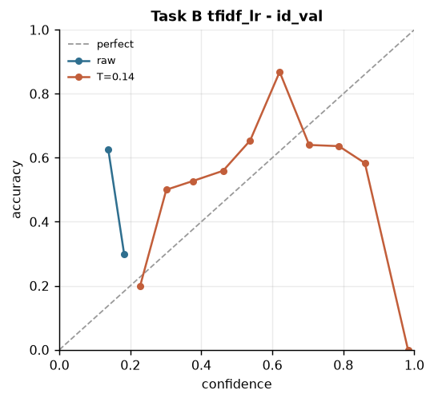
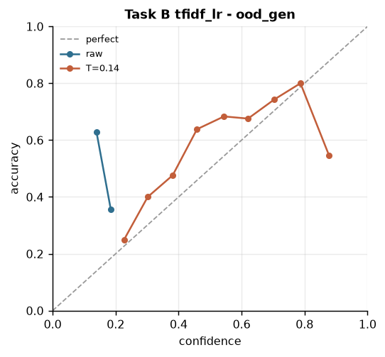
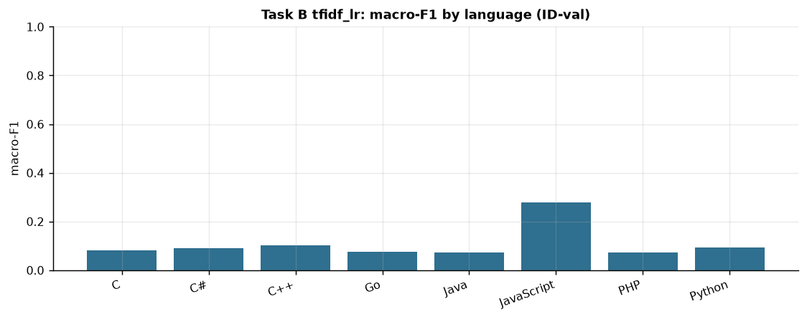

## Speed and size

Sequence length 128 tokens, base model `huggingface/CodeBERTa-small-v1`; architectures built fresh (latency is weight-independent).

| model | params total/trainable | device/precision | batch | p50 ms | p95 ms | snippets/s |
|---|---|---|---|---|---|---|
| CodeBERT fine-tune | 83.7M / 83.7M | cpu/fp32 | 1 | 357.3 | 554.8 | 3 |
| CodeBERT fine-tune | 83.7M / 83.7M | cpu/fp32 | 8 | 2236.4 | 3093.4 | 4 |
| CodeBERT fine-tune | 83.7M / 83.7M | cpu/int8_dynamic | 1 | 138.2 | 331.8 | 7 |
| CodeBERT fine-tune | 83.7M / 83.7M | cpu/int8_dynamic | 8 | 797.5 | 1943.0 | 10 |
| GPAD with the bias switched off (control) | 90.8M / 90.8M | cpu/fp32 | 1 | 333.1 | 408.8 | 3 |
| GPAD with the bias switched off (control) | 90.8M / 90.8M | cpu/fp32 | 8 | 1804.7 | 2439.3 | 4 |
| GPAD with the bias switched off (control) | 90.8M / 90.8M | cpu/int8_dynamic | 1 | 168.1 | 284.0 | 6 |
| GPAD with the bias switched off (control) | 90.8M / 90.8M | cpu/int8_dynamic | 8 | 696.2 | 2234.5 | 11 |
| GPAD (entropy bias + style) | 91.4M / 91.4M | cpu/fp32 | 1 | 327.6 | 661.7 | 3 |
| GPAD (entropy bias + style) | 91.4M / 91.4M | cpu/fp32 | 8 | 2594.3 | 3879.5 | 3 |
| GPAD (entropy bias + style) | 91.4M / 91.4M | cpu/int8_dynamic | 1 | 169.2 | 394.5 | 6 |
| GPAD (entropy bias + style) | 91.4M / 91.4M | cpu/int8_dynamic | 8 | 1167.3 | 1731.0 | 7 |
| CodeBERT + LoRA | 83.8M / 0.4M | cpu/fp32 | 1 | 466.7 | 617.1 | 2 |
| CodeBERT + LoRA | 83.8M / 0.4M | cpu/fp32 | 8 | 1461.3 | 2330.5 | 5 |

## Run status

Overall: **failed**, 128 min. Logs are in `results/logs/`.

| stage | status | seconds |
|---|---|---|
| discover | cached | 0 |
| splits | cached | 0 |
| lm_features | skipped | 0 |
| classical | cached | 0 |
| train_A_codebert | cached | 0 |
| train_A_control | ok | 3353 |
| train_A_gpad | ok | 3525 |
| train_B_codebert_weighted | failed | 166 |
| train_B_gpad_entropy_only | failed | 97 |
| stack | failed | 20 |
| evaluate | ok | 15 |
| analyze | ok | 14 |
| bench | ok | 272 |
| report | ok | 1 |
| slides | ok | 1 |
