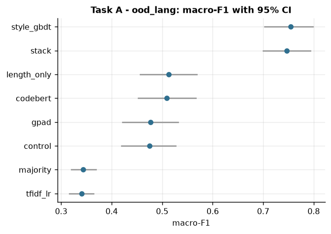
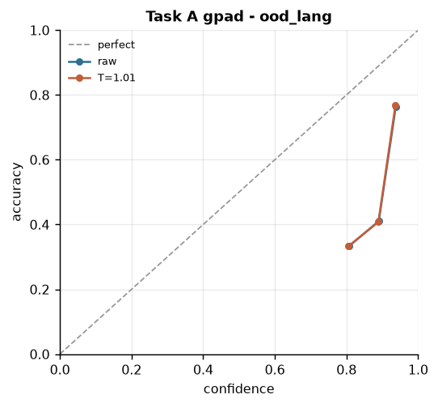
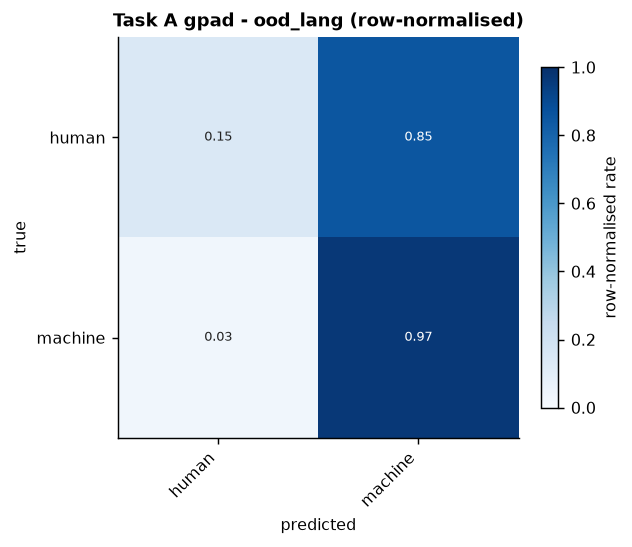

# Results

<!-- BEGIN GENERATED RESULTS - produced by scripts/make_report.py, do not edit by hand -->

*Preset `local_real`, transformer rows use `huggingface/CodeBERTa-small-v1`. Scores are macro-F1 with a 95% bootstrap interval (1000 resamples); every model is scored on the same rows. Generated from `results/*.json`.*

### Key findings

- **The entropy bias adds nothing beyond its extra parameters.** GPAD minus the same model with the bias switched off: +0.003 (in-distribution), +0.007 (official val set), +0.002 (unseen language). No interval rules out zero, so the honest reading is a tie. The original report credited the entropy mechanism for a gain this comparison cannot support.
- **A length-and-whitespace shortcut is hard to beat.** Six content-free features score 0.903 in-distribution and 0.513 on the unseen language; the transformer (`gpad`) is +0.047 and -0.036 against that. Out of distribution it learned formatting, not authorship.
- **Confidence does not survive the shift.** Calibration error (ECE) is 0.027 in-distribution but 0.337 on the unseen language, even after temperature scaling.
- **The default threshold accuses too many humans.** On the unseen language, 0.5 flags 85% of human snippets as machine; a threshold chosen for a 5:1 cost brings that to 38%, still far from usable.
- **Task B is an imbalance problem.** Always guessing the biggest class gives accuracy 0.880 but macro-F1 0.085; the best model here (`tfidf_lr`) reaches macro-F1 0.144. Accuracy alone would hide this.

### Task A - human or machine?

Rows: in-distribution n=300, unseen language n=300.

| model | in-distribution | unseen language |
|---|---|---|
| Style features + gradient boosting | 0.957 [0.933, 0.977] | 0.754 [0.703, 0.798] |
| Stacked ensemble | 0.963 [0.943, 0.983] | 0.747 [0.700, 0.793] |
| Length + whitespace only (shortcut probe) | 0.903 [0.869, 0.936] | 0.513 [0.456, 0.569] |
| CodeBERT fine-tune | 0.943 [0.917, 0.967] | 0.509 [0.452, 0.566] |
| GPAD (entropy bias + style) | 0.950 [0.923, 0.973] | 0.477 [0.421, 0.531] |
| GPAD with the bias switched off (control) | 0.947 [0.920, 0.970] | 0.475 [0.419, 0.527] |
| Majority class (floor) | 0.344 [0.320, 0.367] | 0.344 [0.320, 0.368] |
| Character n-grams + logistic regression | 0.840 [0.797, 0.877] | 0.341 [0.317, 0.364] |

**Humans wrongly flagged as machine** (a false accusation costs 5x a miss; threshold picked on in-distribution data only, model `gpad`):

| threshold | value | in-distribution | unseen language |
|---|---|---|---|
| default (0.5) | 0.50 | 6.3% | 85.3% |
| cost-aware | 0.90 | 3.5% | 37.8% |

### Task B - which model family wrote it?

Rows: in-distribution n=300, unseen generator n=300.

| model | in-distribution | unseen generator |
|---|---|---|
| Character n-grams + logistic regression | 0.144 [0.091, 0.202] | 0.125 [0.088, 0.159] |
| Majority class (floor) | 0.085 [0.083, 0.087] | 0.087 [0.086, 0.089] |

Not in this run (training stage failed or was skipped): `codebert_weighted`, `gpad_entropy_only`.

<!-- END GENERATED RESULTS -->

## Key figures

**Every model on the unseen language, with 95% intervals**

**Confidence vs. accuracy on the unseen language**

**Where the mistakes go on the unseen language**

Every other table (paired tests, stress test, calibration, per-class, speed, run status) and figure: [APPENDIX.md](APPENDIX.md). The ten most confident mistakes per task: [error_analysis_taska.md](error_analysis_taska.md), [error_analysis_taskb.md](error_analysis_taskb.md).
