# Results

Generated by `scripts/make_report.py` from the JSON in `results/`. Do not edit by hand.

<!-- BEGIN GENERATED RESULTS - produced by scripts/make_report.py, do not edit by hand -->

*Preset `local_cpu`, seed 42, 100 bootstrap resamples. Every number below is read from `results/summary.json` / `results/analysis.json`.*

### Task A - human vs machine

Rows per split: `ID val` n=40, `OOD: unseen language` n=40. Every model is scored on the identical rows.

| model | ID val | OOD: unseen language | seeds | seed sd |
|---|---|---|---|---|
| A0b length/whitespace LR (shortcut probe) | 1.000 [1.000, 1.000] | 1.000 [1.000, 1.000] | 2 | 0.000 |
| A3 stylometry + LM entropy/NLL + GBDT | 1.000 [1.000, 1.000] | 1.000 [1.000, 1.000] | 2 | 0.000 |
| A8 stacking (logits + features) | 1.000 [1.000, 1.000] | 1.000 [1.000, 1.000] | 1 | - |
| A2 stylometry + GBDT | 1.000 [1.000, 1.000] | 1.000 [1.000, 1.000] | 2 | 0.000 |
| A1 char 3-5-gram TF-IDF + LR | 1.000 [1.000, 1.000] | 0.740 [0.611, 0.859] | 2 | 0.000 |
| A4 CodeBERT fine-tune | 0.333 [0.245, 0.390] | 0.322 [0.245, 0.385] | 1 | 0.000 |
| A7 capacity control (extra block, bias off) | 0.333 [0.245, 0.390] | 0.322 [0.245, 0.385] | 1 | 0.000 |
| A6 GPAD (entropy bias + style) | 0.333 [0.245, 0.390] | 0.322 [0.245, 0.385] | 1 | 0.000 |
| A6b GPAD, entropy sign flipped | 0.333 [0.245, 0.390] | 0.322 [0.245, 0.385] | 1 | 0.000 |
| A5 CodeBERT + LoRA | 0.333 [0.245, 0.390] | 0.322 [0.245, 0.385] | 1 | 0.000 |
| A0a majority class | 0.333 [0.245, 0.390] | 0.322 [0.245, 0.385] | 1 | 0.000 |

**Paired comparisons** (same rows, 95% bootstrap CI of the macro-F1 difference + McNemar):

| comparison (macro-F1 diff) | split | n | diff [95% CI] | McNemar p | verdict |
|---|---|---|---|---|---|
| gpad - control | ID val | 40 | +0.000 [+0.000, +0.000] | 1 | tie |
| gpad - control | OOD: unseen language | 40 | +0.000 [+0.000, +0.000] | 1 | tie |
| gpad - codebert | ID val | 40 | +0.000 [+0.000, +0.000] | 1 | tie |
| gpad - codebert | OOD: unseen language | 40 | +0.000 [+0.000, +0.000] | 1 | tie |
| gpad_sign_neg - gpad | ID val | 40 | +0.000 [+0.000, +0.000] | 1 | tie |
| gpad_sign_neg - gpad | OOD: unseen language | 40 | +0.000 [+0.000, +0.000] | 1 | tie |
| lora - codebert | ID val | 40 | +0.000 [+0.000, +0.000] | 1 | tie |
| lora - codebert | OOD: unseen language | 40 | +0.000 [+0.000, +0.000] | 1 | tie |
| lm_gbdt - style_gbdt | ID val | 40 | +0.000 [+0.000, +0.000] | 1 | tie |
| lm_gbdt - style_gbdt | OOD: unseen language | 40 | +0.000 [+0.000, +0.000] | 1 | tie |
| tfidf_lr - length_only | ID val | 40 | +0.000 [+0.000, +0.000] | 1 | tie |
| tfidf_lr - length_only | OOD: unseen language | 40 | -0.260 [-0.389, -0.141] | 0.00195 | **significant** |

**Shortcut stress test**

| model | OOD macro-F1 | no comments | drop | comments+format stripped | drop |
|---|---|---|---|---|---|
| A4 CodeBERT fine-tune | 0.322 | 0.322 | +0.000 | 0.322 | +0.000 |
| A7 capacity control (extra block, bias off) | 0.322 | 0.322 | +0.000 | 0.322 | +0.000 |
| A6 GPAD (entropy bias + style) | 0.322 | 0.322 | +0.000 | 0.322 | +0.000 |
| A6b GPAD, entropy sign flipped | 0.322 | 0.322 | +0.000 | 0.322 | +0.000 |
| A5 CodeBERT + LoRA | 0.322 | 0.322 | +0.000 | 0.322 | +0.000 |

**Calibration**

Temperature fitted on ID-val: **T = 9.94** (model `gpad`)

| split | ECE raw | ECE after temperature |
|---|---|---|
| ID val | 0.140 | 0.014 |
| OOD: unseen language | 0.163 | 0.039 |

**Operating point**

Cost ratio: a false accusation (FP) is **5x** the cost of a miss. Threshold chosen on ID-val only, then applied unchanged to OOD.

| split | rule | threshold | precision (machine) | recall (machine) | false-accusation rate | cost / 1000 snippets |
|---|---|---|---|---|---|---|
| ID val | argmax_0.5 | 0.50 | 0.000 | 0.000 | 0.000 | 500 |
| ID val | cost_optimal | 0.49 | 0.000 | 0.000 | 0.000 | 500 |
| OOD: unseen language | argmax_0.5 | 0.50 | 0.000 | 0.000 | 0.000 | 525 |
| OOD: unseen language | cost_optimal | 0.49 | 0.000 | 0.000 | 0.000 | 525 |

**Per-class breakdown**

Model `gpad`, split `id_val`:

| class | precision | recall | F1 | support |
|---|---|---|---|---|
| human | 0.500 | 1.000 | 0.667 | 20 |
| machine | 0.000 | 0.000 | 0.000 | 20 |

**Feature importance**

| feature | macro-F1 drop when shuffled (ID-val) |
|---|---|
| log_lines | +0.5400 |
| mean_line_len | +0.0000 |
| max_line_len | +0.0000 |
| blank_ratio | +0.0000 |
| mean_indent | +0.0000 |
| tab_ratio | +0.0000 |
| trailing_ws_ratio | +0.0000 |
| comment_line_ratio | +0.0000 |
| mean_ident_len | +0.0000 |
| unique_ident_ratio | +0.0000 |

### Task B - which LLM family

Rows per split: `ID val` n=40, `OOD: unseen generator` n=40. Every model is scored on the identical rows.

| model | ID val | OOD: unseen generator | seeds | seed sd |
|---|---|---|---|---|
| B5 GPAD (entropy + style) | 0.120 [0.060, 0.187] | 0.166 [0.127, 0.193] | 1 | 0.000 |
| A8 stacking (logits + features) | 0.286 [0.194, 0.369] | 0.143 [0.143, 0.143] | 1 | - |
| A1 char 3-5-gram TF-IDF + LR | 0.221 [0.161, 0.287] | 0.125 [0.110, 0.136] | 2 | 0.000 |
| B2 CodeBERT + weighted CE | 0.092 [0.074, 0.110] | 0.098 [0.076, 0.115] | 1 | 0.000 |
| B3 GPAD entropy-only | 0.092 [0.074, 0.110] | 0.098 [0.076, 0.115] | 1 | 0.000 |
| A0a majority class | 0.092 [0.074, 0.110] | 0.098 [0.076, 0.115] | 1 | 0.000 |
| B4 GPAD style-only | 0.058 [0.016, 0.096] | 0.000 [0.000, 0.000] | 1 | 0.000 |

**Paired comparisons** (same rows, 95% bootstrap CI of the macro-F1 difference + McNemar):

| comparison (macro-F1 diff) | split | n | diff [95% CI] | McNemar p | verdict |
|---|---|---|---|---|---|
| gpad_entropy_only - codebert_weighted | ID val | 40 | +0.000 [+0.000, +0.000] | 1 | tie |
| gpad_entropy_only - codebert_weighted | OOD: unseen generator | 40 | +0.000 [+0.000, +0.000] | 1 | tie |
| gpad_both - codebert_weighted | ID val | 40 | +0.028 [-0.038, +0.097] | 0.0127 | tie |
| gpad_both - codebert_weighted | OOD: unseen generator | 40 | +0.067 [+0.029, +0.096] | 0.572 | **significant** |
| tfidf_lr - majority | ID val | 40 | +0.129 [+0.063, +0.184] | 0.125 | **significant** |
| tfidf_lr - majority | OOD: unseen generator | 40 | +0.027 [+0.016, +0.039] | 1 | **significant** |

**Shortcut stress test**

| model | OOD macro-F1 | no comments | drop | comments+format stripped | drop |
|---|---|---|---|---|---|
| B2 CodeBERT + weighted CE | 0.098 | 0.098 | +0.000 | 0.098 | +0.000 |
| B5 GPAD (entropy + style) | 0.166 | 0.000 | +0.166 | 0.128 | +0.038 |
| B3 GPAD entropy-only | 0.098 | 0.098 | +0.000 | 0.098 | +0.000 |
| B4 GPAD style-only | 0.000 | 0.000 | +0.000 | 0.000 | +0.000 |

**Calibration**

Temperature fitted on ID-val: **T = 0.25** (model `gpad_both`)

| split | ECE raw | ECE after temperature |
|---|---|---|
| ID val | 0.041 | 0.064 |
| OOD: unseen generator | 0.266 | 0.219 |

**Per-class breakdown**

Model `gpad_both`, split `id_val`:

| class | precision | recall | F1 | support |
|---|---|---|---|---|
| human | 1.000 | 0.263 | 0.417 | 19 |
| deepseek | 0.000 | 0.000 | 0.000 | 3 |
| qwen | 0.000 | 0.000 | 0.000 | 3 |
| bigcode | 0.167 | 0.667 | 0.267 | 3 |
| meta-llama | 0.000 | 0.000 | 0.000 | 4 |
| mistral | 0.100 | 0.333 | 0.154 | 3 |
| openai | 0.000 | 0.000 | 0.000 | 5 |

### Efficiency

Sequence length 64 tokens, base model `hf-internal-testing/tiny-random-RobertaModel`; architectures built fresh (latency is weight-independent).

| model | params total/trainable | device/precision | batch | p50 ms | p95 ms | snippets/s |
|---|---|---|---|---|---|---|
| A4 CodeBERT fine-tune | 0.1M / 0.1M | cpu/fp32 | 1 | 20.2 | 24.4 | 50 |
| A4 CodeBERT fine-tune | 0.1M / 0.1M | cpu/fp32 | 8 | 23.5 | 47.5 | 340 |
| A4 CodeBERT fine-tune | 0.1M / 0.1M | cpu/int8_dynamic | 1 | 67.8 | 98.8 | 15 |
| A4 CodeBERT fine-tune | 0.1M / 0.1M | cpu/int8_dynamic | 8 | 127.2 | 189.0 | 63 |
| A7 capacity control (extra block, bias off) | 0.1M / 0.1M | cpu/fp32 | 1 | 19.9 | 26.5 | 50 |
| A7 capacity control (extra block, bias off) | 0.1M / 0.1M | cpu/fp32 | 8 | 28.8 | 44.7 | 278 |
| A7 capacity control (extra block, bias off) | 0.1M / 0.1M | cpu/int8_dynamic | 1 | 69.5 | 106.0 | 14 |
| A7 capacity control (extra block, bias off) | 0.1M / 0.1M | cpu/int8_dynamic | 8 | 101.3 | 167.8 | 79 |
| A6 GPAD (entropy bias + style) | 0.1M / 0.1M | cpu/fp32 | 1 | 92.9 | 106.4 | 11 |
| A6 GPAD (entropy bias + style) | 0.1M / 0.1M | cpu/fp32 | 8 | 33.5 | 55.9 | 239 |
| A6 GPAD (entropy bias + style) | 0.1M / 0.1M | cpu/int8_dynamic | 1 | 566.4 | 581.7 | 2 |
| A6 GPAD (entropy bias + style) | 0.1M / 0.1M | cpu/int8_dynamic | 8 | 191.4 | 256.5 | 42 |
| A5 CodeBERT + LoRA | 0.1M / 0.0M | cpu/fp32 | 1 | 17.2 | 20.2 | 58 |
| A5 CodeBERT + LoRA | 0.1M / 0.0M | cpu/fp32 | 8 | 24.4 | 67.9 | 327 |

### What the numbers say

- **The attention-entropy bias does not survive its control.** Against the parameter-matched control (same extra block, bias off), the macro-F1 difference is ID val: +0.000 [+0.000, +0.000], OOD: unseen language: +0.000 [+0.000, +0.000] - every interval contains zero, so the honest reading is *no gain beyond capacity*. The original report credited the entropy mechanism for a gain this comparison cannot support.
- **Shortcut probe.** A logistic regression on nothing but length and whitespace reaches macro-F1 1.000 in-distribution and 1.000 on the held-out language; the transformer (`gpad`) is -0.667 / -0.678 above that. The size of that gap is how much of the task is actually about authorship rather than formatting.
- **Stress test.** Stripping comments and normalising whitespace on the *same* OOD rows moves `codebert` by +0.000 macro-F1 (0.322 -> 0.322).
- **Calibration breaks under shift.** After temperature scaling fitted on ID-val, ECE is 0.014 on ID val but 0.039 on OOD: unseen language: a confidence number calibrated in-distribution is not trustworthy off-distribution.
- **Task B is an imbalance problem.** The majority-class baseline already scores accuracy 0.475 with macro-F1 0.092; the best model reaches macro-F1 0.286 (accuracy 0.600, `stack`). Reporting accuracy here would have hidden the whole problem - which is what the original run did.
- **The old 'entropy-only is best' claim.** Re-tested against weighted CodeBERT on identical rows: no significant difference.

<!-- END GENERATED RESULTS -->

## Figures

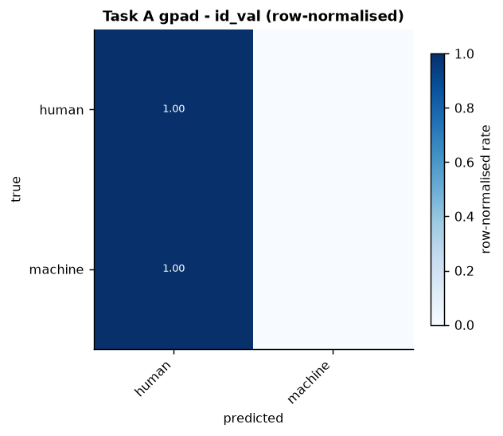

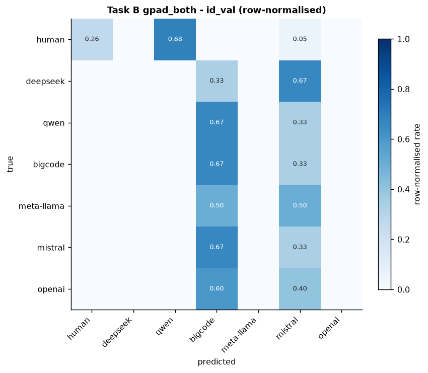
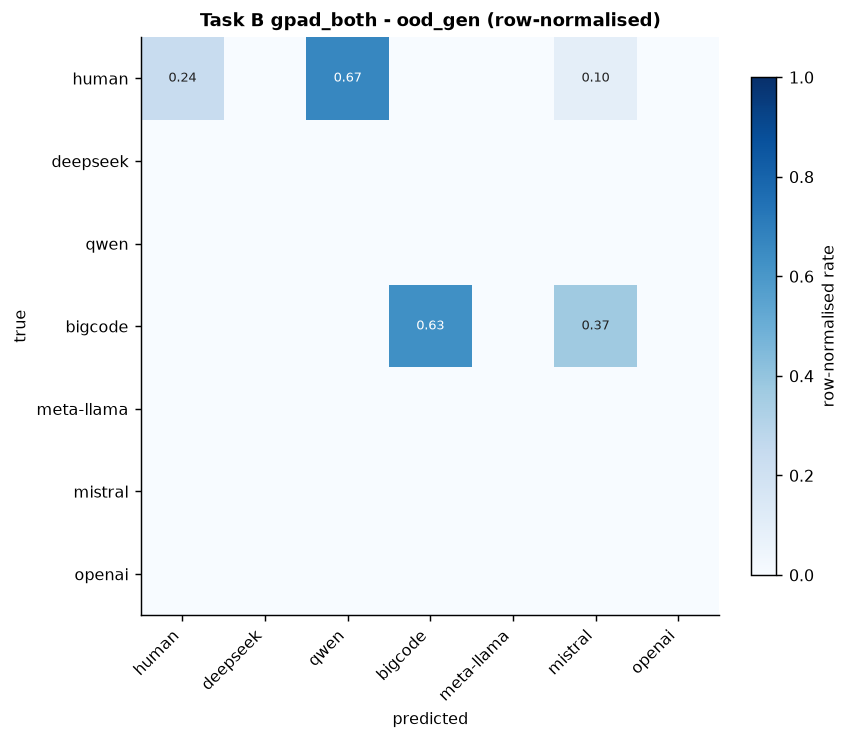
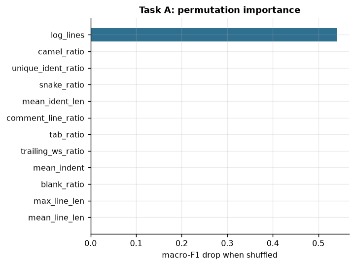
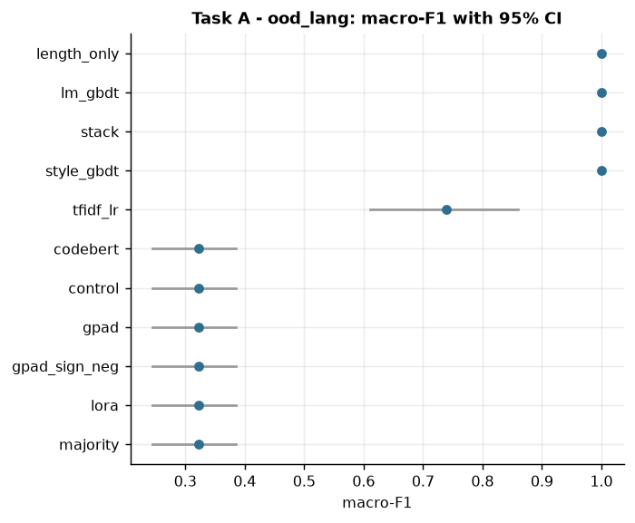
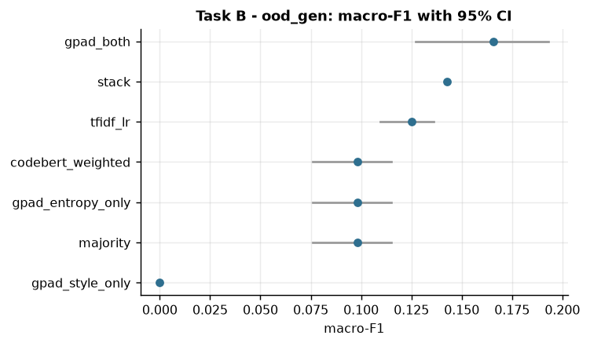
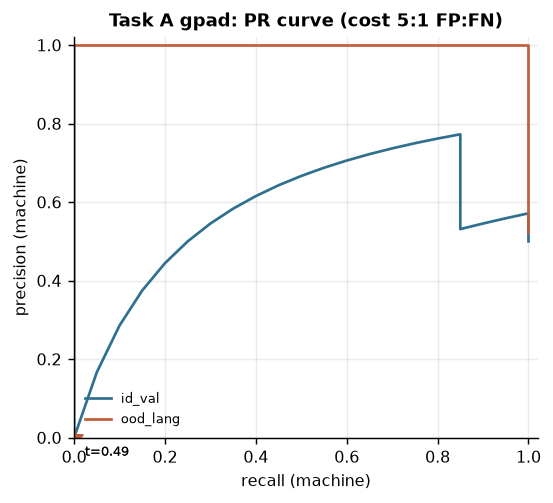
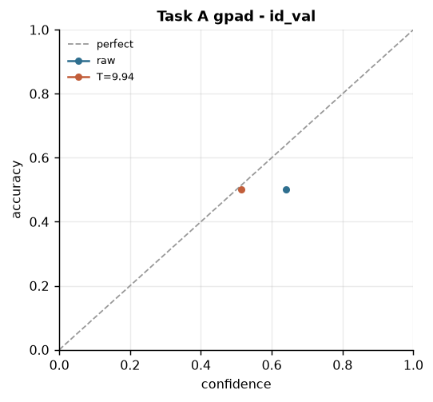
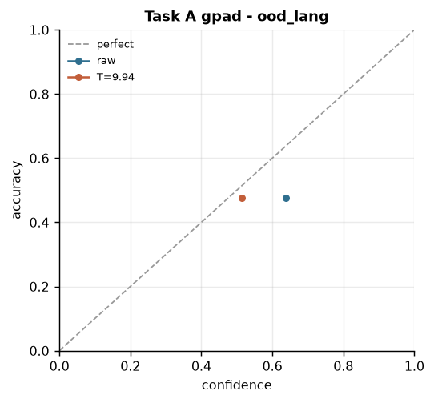
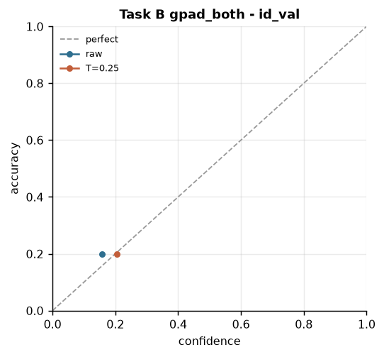
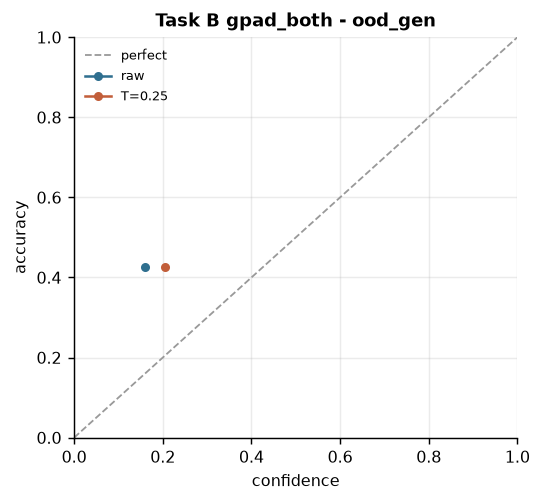
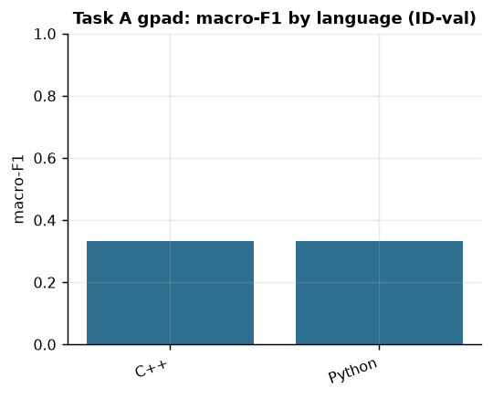
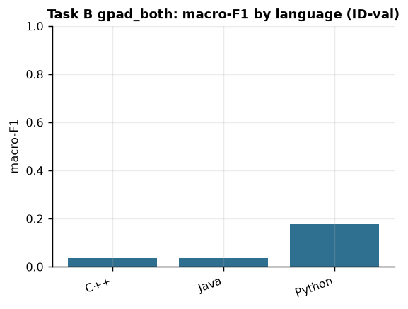

## Run status

| stage | status | seconds | note |
|---|---|---|---|
| discover | ok | 2 |  |
| splits | ok | 10 |  |
| lm_features | ok | 36 |  |
| classical | ok | 12 |  |
| train_A_codebert | ok | 44 |  |
| train_A_gpad | ok | 49 |  |
| train_A_control | ok | 66 |  |
| train_A_gpad_sign_neg | ok | 54 |  |
| train_A_lora | ok | 41 |  |
| train_B_codebert_weighted | ok | 45 |  |
| train_B_gpad_entropy_only | ok | 50 |  |
| train_B_gpad_style_only | ok | 50 |  |
| train_B_gpad_both | ok | 48 |  |
| stack | ok | 18 |  |
| evaluate | ok | 8 |  |
| analyze | ok | 14 |  |
| bench | ok | 58 |  |
